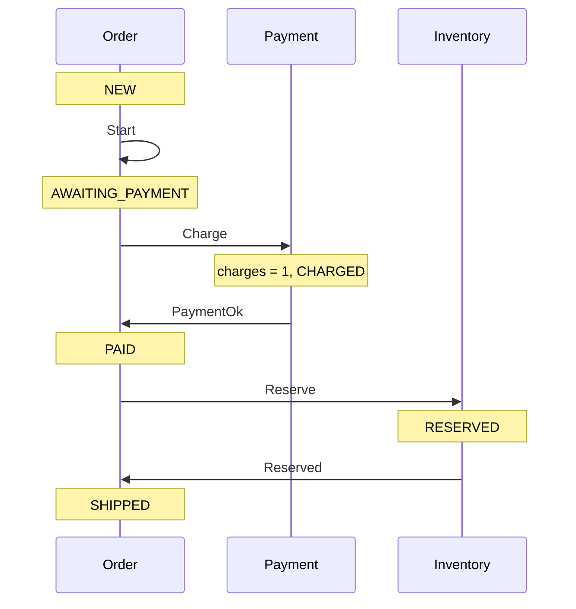
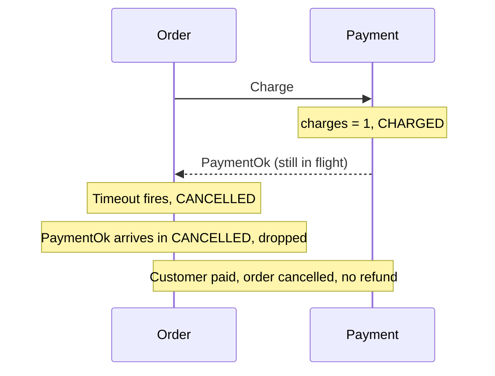
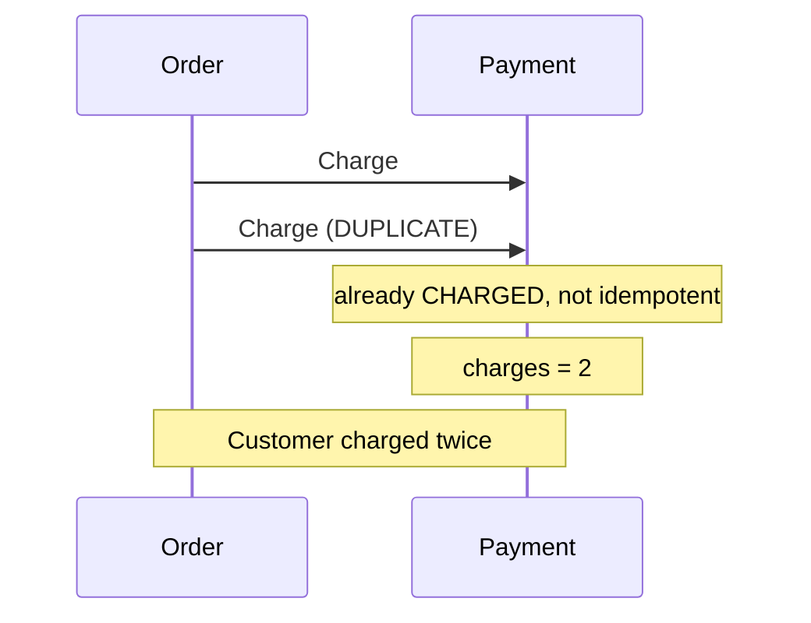
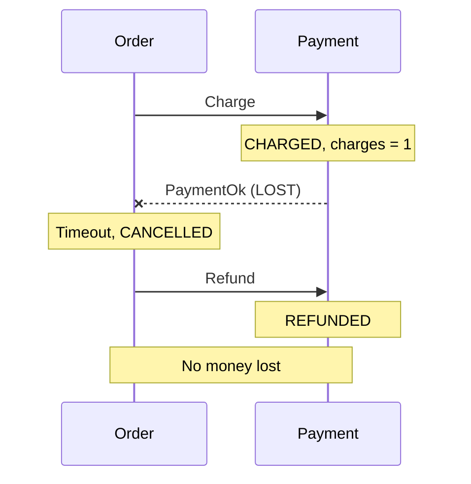
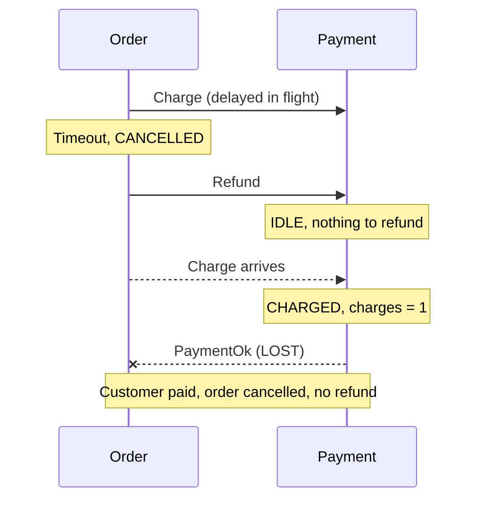
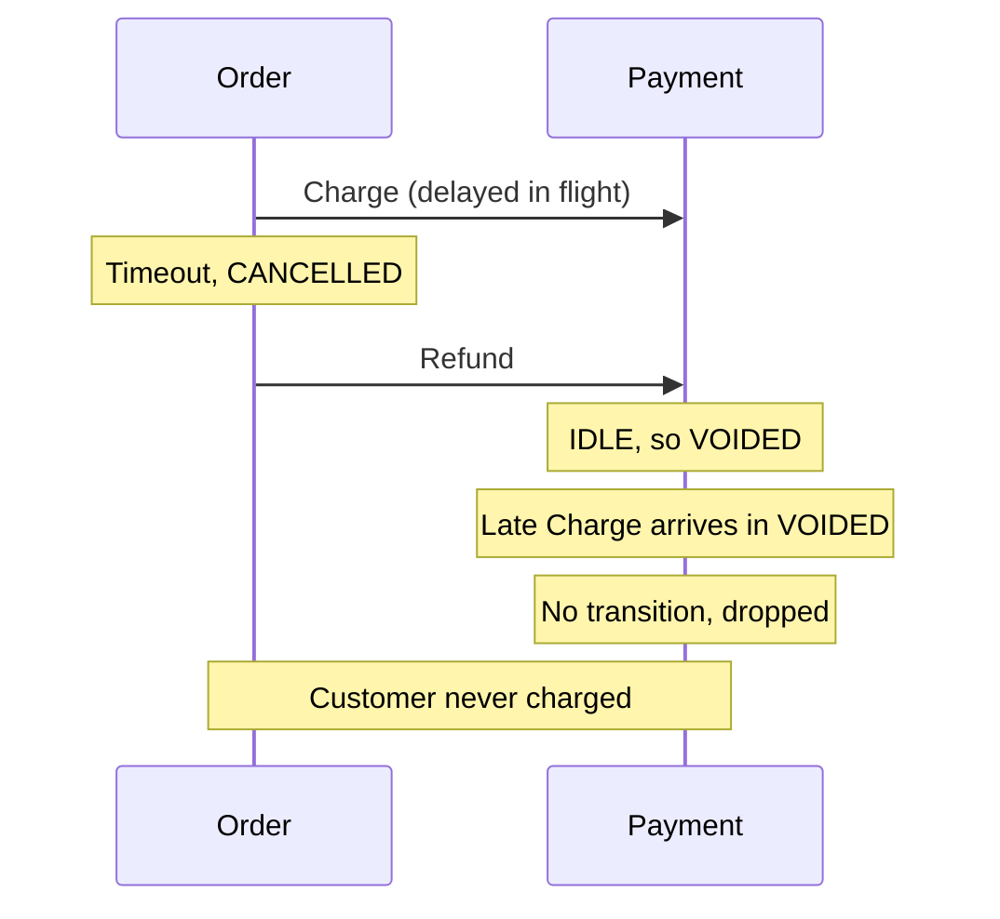

# Sequence diagrams

## Happy path

## v1 mishap: late reply, then timeout

## v1 mishap: duplicate Charge

## v2 fix: timeout triggers refund

## v2 mishap: refund arrives before charge

## v3 fix: Payment remembers the refund

